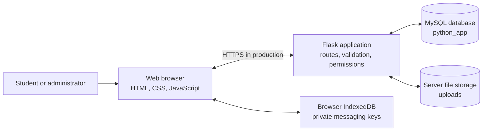
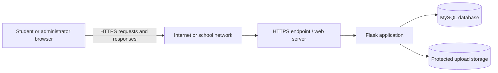
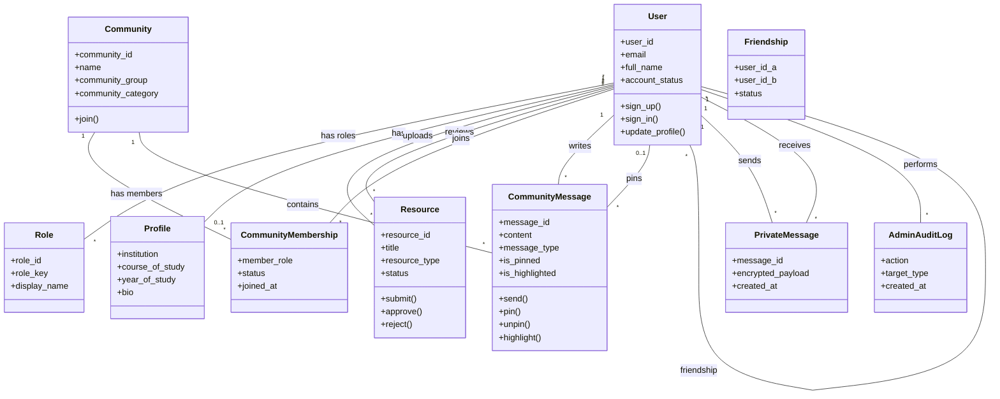

# 4. System Design Phase

## 4.2 System Design (Description of the Proposed System)

Acadex is a web-based learning and student-support portal. It gives students one place to find learning resources, connect with other students, and take part in subject communities. Administrators use a separate dashboard to manage student accounts, review resources, and view system activity.

Students use a web browser to create an account, sign in, update their profile, search for learning resources, submit resources for review, find classmates, and join communities. Community chats support ordinary messages and announcements. A message can be pinned or highlighted to make it easier for members to notice. Students can also send private messages to accepted friends.

Administrators sign in with an administrator account. They can approve or reject student uploads, publish or archive learning materials, manage student accounts, and review audit records. A student's upload is not made available to other students until it has been approved.

### Main parts of the system

1. **Student website:** screens for the learning library, friends, community chats, and profile.
2. **Administrator website:** screens for reviewing materials, managing student accounts, and viewing activity.
3. **Application server:** a Python Flask application. It processes requests, checks sign-in and permissions, validates submitted information, and communicates with the database.
4. **Database:** MySQL stores accounts, roles, profiles, communities, memberships, messages, resource details, and administrative records.
5. **File storage:** uploaded learning materials and encrypted private-message attachments are stored as files on the application server. MySQL stores information about the files, not their contents.
6. **Browser storage:** private-message encryption keys are held in the user's browser. A private key is not stored in MySQL.

The proposed system keeps the existing browser–Flask–MySQL design. It does not require students to install a separate application. Users need an internet connection and a modern browser.

## 4.3 Architectural Design

### 4.3.1 Software Architectural Design

Acadex uses a simple layered web architecture:

| Layer | What it does | Current technology |
|---|---|---|
| Presentation | Displays pages, forms, menus, messages, and results. | HTML, CSS, and browser JavaScript |
| Application | Applies rules, checks permissions, validates requests, and prepares responses. | Python and Flask |
| Data access | Reads and changes saved records using SQL. | MySQL Connector and parameterized SQL |
| Data storage | Keeps application records and references to uploaded files. | MySQL database named `python_app` |
| File storage | Holds uploaded resource files and encrypted direct-message attachments. | Server folders under `uploads/` |

When a student clicks a button, the browser sends a request to Flask. Flask checks that the user is signed in and allowed to perform the action, then reads or updates MySQL. The server returns a response, and the browser updates the page.



The browser is responsible for displaying the user interface. Flask is responsible for enforcing business rules; hiding a button in the browser is not treated as a security check. MySQL is the main source of saved application data.

**Important security distinction:** direct private messages are encrypted in the browser before they are stored. Community chat messages and announcements are currently stored as ordinary text in MySQL. They are protected by sign-in, membership checks, and HTTPS in production, but they do not have the same end-to-end encryption as direct messages.

### 4.3.2 Hardware Architectural Design

The system has three hardware roles:

| Hardware | Role |
|---|---|
| Student or administrator device | Runs a web browser and displays the application. This may be a laptop, desktop, tablet, or smartphone. |
| Application/database computer | Runs the Flask application and MySQL. During local development, these can run on one computer using XAMPP and Python. |
| Backup storage | Holds protected copies of the database and uploaded files. For a real deployment, it should be separate from the application computer. |

For a classroom demonstration or small local project, one computer can run Flask and MySQL. For a multi-user deployment, use a server with enough memory, processor capacity, and storage for the expected number of users and uploaded files. Exact hardware capacity should be selected after measuring expected usage; it cannot be determined from the source code alone.

The production system should avoid using a student's personal computer as the only server or as the only place where backups are stored. If the server stops working, users may lose access until it is repaired.

### 4.3.3 Network Architectural Design

In development, a user can open Acadex on the same computer using a local address such as `http://127.0.0.1:5000/`. This is suitable for local testing, not public deployment.

For a production deployment, users connect over HTTPS. HTTPS encrypts the connection between the browser and the server, helping protect passwords, session cookies, and other information while it travels across the network.



The database and uploaded-file folders should not be directly exposed to the public internet. Users should reach application data through Flask routes, where the application can check permissions. The production database should accept connections only from the application server or other specifically approved systems.

### 4.3.4 Conceptual Class Diagram

The diagram below describes the main system concepts. It is a design view of the database and application, not a claim that the Python application is implemented as one Python class for every box.



In the diagram, `*` means “many.” For example, one community can contain many messages. Community members can manage their own messages; owners and moderators can manage messages in their community.

## 4.4 Physical Design

Physical design describes where the running parts and files are placed.

### Development arrangement

- The project files are placed in the Acadex application folder.
- Flask serves the website and API.
- MySQL runs locally, commonly through XAMPP.
- Resource uploads are kept under `uploads/resources/`.
- Encrypted private-message attachments are kept under `uploads/private_messages/`.
- The `.env` file holds local configuration such as database credentials and the Flask secret. It must not be published or committed.

### Recommended production arrangement

- Deploy the Flask application to a maintained server.
- Keep MySQL on the same protected server or on a separate private database server.
- Keep uploaded files on protected storage that only the application can access.
- Use a separate, access-controlled location for backups.
- Configure HTTPS at the public web-server endpoint.
- Restrict administrative access to the operating system, database, and backup storage.

The exact server names, disk sizes, and network addresses depend on the institution's hosting environment and user load. They should be recorded when the real deployment location is selected.

## 4.5 Database Design

The system uses a relational MySQL database named `python_app`. Related information is split into tables so it can be searched and updated consistently.

| Table or group | Purpose in simple terms |
|---|---|
| `users`, `roles`, `user_roles` | Stores account details and whether each account is a student or administrator. |
| `profiles` | Stores optional study and profile information for an account. |
| `resources` | Stores titles, categories, file locations, and approval status for learning materials. |
| `friendships` | Stores student connection requests and whether they have been accepted. |
| `communities`, `community_members` | Stores communities and the users who have joined them, including their community role. |
| `community_messages` | Stores ordinary community chat messages and announcements, including pin and highlight settings. |
| `private_messages` | Stores encrypted direct-message payloads between accepted friends. |
| `private_message_attachments` | Stores information about encrypted files shared in private messages. |
| `admin_audit_log` | Records important administrator actions. |
| `student_login_sessions` | Records login activity used for the student activity report. |

Primary keys uniquely identify records. Foreign keys connect records, such as a community message to its author and community. Indexes help the database find records more quickly. Account roles, resource statuses, and community memberships are checked by the application before protected operations are allowed.

Community announcements are rows in `community_messages` with the type `announcement`; they are not a separate community-post feed. Pinning and highlighting are separate settings. Unpinning clears the pin information but leaves the message and its highlight setting unchanged. Migration 13 copies existing community posts into chat as announcements and uses a unique legacy-post reference to avoid importing the same post twice.

Uploaded file bytes are not stored in MySQL. The database stores their metadata and server-side file references. Therefore, a complete backup must include both the MySQL database and the upload folders.

See [database/DATABASE_DESIGN.md](database/DATABASE_DESIGN.md) for the detailed entity-relationship diagram, keys, constraints, and table descriptions.

## 4.6 Program Design (Program Pseudocode)

Pseudocode describes the steps a program follows without using the exact syntax of a programming language.

### A. Sign in

```text
START sign-in
    Receive email and password
    Find the account using the email
    IF account does not exist OR password does not match
        Show a sign-in error
        STOP
    END IF
    IF account is suspended or inactive
        Deny sign-in and show an account-status message
        STOP
    END IF
    Check the account's role
    Create a signed-in session
    IF user is an administrator
        Open the administrator dashboard
    ELSE
        Open the student dashboard
    END IF
END sign-in
```

### B. Submit and review a learning resource

```text
START resource submission
    Check that the student is signed in
    Receive resource details and selected file
    Check required fields, allowed file type, and file-size limit
    IF any input is invalid
        Return an error and do not save the resource
        STOP
    END IF
    Save the file in protected upload storage
    Save the resource details with status "pending"
    Tell the student that the resource is waiting for review
END resource submission

START administrator review
    Check that the signed-in user is an active administrator
    Receive the resource and review decision
    IF the resource is not waiting for review
        Return an error
        STOP
    END IF
    Save the approval or rejection and reviewer information
    Record the action in the audit log
    Show the updated review result
END administrator review
```

### C. Send a community message or announcement

```text
START send community message
    Check that the user is signed in as a student
    Check that the community is active
    Check that the user is an active member of the community
    Receive message text and message type
    Check that the text is present and within the allowed length
    Check that the type is "message" or "announcement"
    IF any check fails
        Return an error without saving the message
        STOP
    END IF
    Save the message with its author, community, and type
    Return the saved message to the browser
    Display the message in the community chat
END send community message
```

### D. Pin, unpin, or highlight a message

```text
START update community message
    Check that the user is signed in
    Check that the user is an active member of the community
    Find the message in that community
    IF the message does not exist
        Return "message not found"
        STOP
    END IF
    Allow the change only if the user wrote the message
        OR the user is a community owner or moderator
    IF the user is not allowed
        Return "not allowed"
        STOP
    END IF
    IF pin setting is turned on
        Save the pin state, pinner, and pin time
    ELSE IF pin setting is turned off
        Clear the pin state, pinner, and pin time
        Keep the message and its highlight setting
    END IF
    IF highlight setting was provided
        Save the new highlight setting
    END IF
    Return the updated message
END update community message
```

## 4.7 Interface Design

### 4.7.1 Menu Interface Design

The student dashboard uses a main navigation menu with these areas:

- **Library:** find and submit learning resources.
- **Friends:** find students, respond to friend requests, and open private conversations.
- **Communities:** discover or create communities and open joined community chats.
- **Profile:** view and update study and personal profile information.
- **Logout:** end the signed-in session.

The community area contains a **Discover** view and a **Conversations** view. The Discover view helps a student find communities by group and topic. The Conversations view lists joined community chats. The administrator dashboard has separate tools for student accounts, resource review, course materials, and audit records.

### 4.7.2 Input Design

Input design is about making it clear what users can enter and checking their entries before saving them.

| Input | Example checks |
|---|---|
| Email and password | Required fields; password is checked against the stored password hash. |
| Profile details | Text length and valid field values are checked. |
| Community name and topic | Name is required; group and topic must be supported choices. |
| Community chat message | Text is required, at most 2,000 characters, and type must be `message` or `announcement`. |
| Pin and highlight controls | Accept only true/false values; server checks membership, authorship, and moderator role. |
| Resource upload | Required details, allowed document format, and the 10 MB limit are checked before accepting the upload. |
| Administrator review | The decision must be an allowed review status and the user must be an active administrator. |

The browser provides helpful feedback, but Flask repeats important validation and permission checks because browser checks alone can be bypassed.

### 4.7.3 Output Design

The system returns information in two ways:

1. **Visual page output:** the browser displays lists, community messages, status labels, forms, and administrator reports.
2. **API output:** Flask returns structured JSON data to the browser. If a request cannot be completed, it returns an error response with a message.

Examples of outputs include:

- A resource list showing approved items to students.
- A pending or approved status after a resource submission or review.
- Community messages with clear **Announcement**, **Pinned**, and **Important** labels when those settings apply.
- An error message if the user is not a community member or cannot manage a message.
- A confirmation after a successful sign-in, message send, pin, unpin, or highlight change.

The interface should not show a success message unless the server confirms the operation was saved.

## 4.8 Security and Backup Design (Software Concerns)

### Security design

- **Sign-in:** passwords are stored as password hashes, not readable passwords. Password-reset codes expire and have limited verification attempts.
- **Roles and permissions:** Flask checks whether a user is a student or administrator before protected actions. Community message operations also check active membership and the user's author, owner, or moderator permission.
- **Database safety:** database queries should use parameters rather than joining user input directly into SQL. Database credentials and the Flask secret belong in protected configuration, not public source files.
- **Web connection:** production use should be over HTTPS. The local development address is not a secure public deployment.
- **File uploads:** enforce the allowed file types and size limits. Store uploads in protected folders and serve them only after checking the user's permission.
- **Private messages:** direct messages and their attachments are encrypted in the browser. Private keys remain in browser storage, so users can lose access if browser data is removed or unavailable. Key verification uses a separate trusted channel; the current design does not provide forward secrecy.
- **Community messages:** community messages and announcements are plain text in the database. Do not describe community chat as end-to-end encrypted.
- **Error handling:** show users a safe, useful message. Record technical details in protected server logs rather than exposing database credentials or internal traces in the page.
- **Administrator activity:** record important administrator operations in the audit log and limit access to that log to active administrators.

### Backup design

The following is a recommended backup process; it should be configured and tested in the hosting environment:

1. Schedule regular MySQL backups of the `python_app` database.
2. Back up `uploads/resources/` and `uploads/private_messages/` at the same time or on a coordinated schedule.
3. Encrypt backup files and store them in a separate, access-controlled location.
4. Keep more than one recent backup so an accidental change or damaged backup does not remove all recovery points.
5. Do not include `.env` credentials in an unprotected backup location. Protect any copy needed for disaster recovery separately.
6. Periodically restore a backup to a test database and test file location to confirm the system can be recovered.
7. Limit backup access to the people responsible for operating the system and record backup and restore activity.

A database backup without the upload folders cannot restore uploaded documents or private-message attachment files. Browser-only private keys are not in the database or server backups and cannot be recovered by restoring the server.

### Current implementation and deployment notes

The current project provides local Flask/MySQL operation, account and role checks, upload validation, server-side community membership checks, direct-message encryption, and administrator audit functions. Production HTTPS, separate protected backup storage, scheduled backup retention, and tested restoration must be configured for the chosen server; their presence should not be assumed from the application code alone.
