# Acadex Database Design

## 1. Purpose and scope

This document describes the MySQL schema defined by `database/01_accounts.sql` through `database/13_community_chat.sql`. It reflects the current SQL definitions, including tables present as academic or administrative extensions but not yet used by the Flask API.

The database is named `python_app`. Tables use InnoDB, `utf8mb4`, and the `utf8mb4_unicode_ci` database collation. Primary and foreign keys use unsigned numeric IDs except where noted. Migration 13 matches community and user ID column types to the existing database so it also works with earlier signed `INT` schemas. Application uploads, browser-only data, and migration behavior are described separately because they are not stored as ordinary relational data.

## 2. Conceptual entity-relationship diagram

```mermaid
erDiagram
    USERS ||--o{ USER_ROLES : assigned
    ROLES ||--o{ USER_ROLES : contains
    USERS ||--o| PROFILES : has
    USERS ||--o{ USER_SESSIONS : owns
    USERS ||--o{ PASSWORD_RESET_TOKENS : requests
    USERS ||--o{ USER_COURSES : enrolls
    COURSES ||--o{ USER_COURSES : includes
    COURSES o|--o{ RESOURCES : classifies
    USERS ||--o{ RESOURCES : uploads
    USERS o|--o{ RESOURCES : reviews
    USERS ||--o{ SAVED_RESOURCES : saves
    RESOURCES ||--o{ SAVED_RESOURCES : bookmarked
    USERS ||--o{ RESOURCE_PROGRESS : tracks
    RESOURCES ||--o{ RESOURCE_PROGRESS : viewed
    USERS ||--o{ ASSIGNMENTS : owns
    COURSES o|--o{ ASSIGNMENTS : relates_to
    USERS ||--o{ FRIENDSHIPS : participant_a
    USERS ||--o{ FRIENDSHIPS : participant_b
    USERS ||--o{ FRIENDSHIPS : requested_by
    COURSES o|--o{ COMMUNITIES : relates_to
    USERS o|--o{ COMMUNITIES : creates
    COMMUNITIES ||--o{ COMMUNITY_MEMBERS : has
    USERS ||--o{ COMMUNITY_MEMBERS : joins
    COMMUNITIES ||--o{ COMMUNITY_POSTS : contains
    USERS ||--o{ COMMUNITY_POSTS : authors
    COMMUNITIES ||--o{ COMMUNITY_MESSAGES : contains
    USERS ||--o{ COMMUNITY_MESSAGES : authors
    USERS o|--o{ COMMUNITY_MESSAGES : pins
    USERS ||--o{ ADMIN_AUDIT_LOG : performs
    USERS ||--o| USER_ENCRYPTION_KEYS : publishes
    USERS ||--o{ PRIVATE_MESSAGES : sends
    USERS ||--o{ PRIVATE_MESSAGES : receives
    USERS ||--o{ PRIVATE_MESSAGE_ATTACHMENTS : sends_attachment
    USERS ||--o{ PRIVATE_MESSAGE_ATTACHMENTS : receives_attachment
    PRIVATE_MESSAGES o|--o{ PRIVATE_MESSAGE_ATTACHMENTS : may_include
    USERS ||--o{ STUDENT_LOGIN_SESSIONS : records
```

`STUDENT_ACTIVITY_TRACKING` is a singleton marker table and has no entity relationship. In `FRIENDSHIPS`, `participant_a` and `participant_b` refer to the same `USERS` table; the pair is stored in ascending ID order.

## 3. Logical schema

### Accounts and authorization

| Table | Columns and purpose | Keys and rules |
|---|---|---|
| `users` | `user_id` BIGINT UNSIGNED; `email` VARCHAR(254); `password_hash` VARCHAR(255); `full_name` VARCHAR(150); nullable `student_number` VARCHAR(64); `account_status` (`active`, `pending`, `suspended`, `deleted`); `created_at`, `updated_at`, nullable `last_login_at`. | PK `user_id`; unique email and nullable student number. New accounts receive the `student` role through a database trigger. |
| `roles` | `role_id` SMALLINT UNSIGNED; `role_key` VARCHAR(32); `display_name` VARCHAR(64). | PK `role_id`; unique `role_key`. Seeded roles: `student` and `admin`. |
| `user_roles` | `user_id`, `role_id`, `assigned_at`. | Composite PK (`user_id`, `role_id`); user deletion cascades; referenced role deletion is restricted. |
| `user_sessions` | `session_id`; `user_id`; `token_hash` CHAR(64); `created_at`; `expires_at`; nullable `revoked_at`. | PK `session_id`; unique token hash; FK to `users` with cascade delete; indexed by user and expiry. Defined in SQL but not currently read or written by the Flask API. |
| `password_reset_tokens` | `reset_id`; `user_id`; `token_hash` CHAR(64); `failed_attempts` TINYINT UNSIGNED; `created_at`; `expires_at`; nullable `used_at`. | PK `reset_id`; unique token hash; FK to `users` with cascade delete; indexed by user and expiry. The API stores a hash, limits verification attempts, and marks a token used. |

### Profiles and academic data

| Table | Columns and purpose | Keys and rules |
|---|---|---|
| `profiles` | `user_id`; nullable `institution`, `course_of_study`, `year_of_study`, `bio`, `avatar_url`; `updated_at`. | PK and FK `user_id` to `users`; one profile per account; cascade delete. The API persists profile text and study details. Avatar images are currently browser-local, not stored here. |
| `courses` | `course_id`; nullable `course_code`; `name`; nullable `description`, `institution`; `is_active`; `created_at`. | PK `course_id`; unique nullable `course_code`. |
| `user_courses` | `user_id`, `course_id`; `enrollment_status` (`current`, `completed`, `withdrawn`); `progress_percent`; `enrolled_at`. | Composite PK (`user_id`, `course_id`); FKs to users and courses cascade; progress is constrained to 0–100. |
| `assignments` | `assignment_id`; `user_id`; nullable `course_id`; `title`; nullable `description`, `due_at`; `status` (`upcoming`, `in_progress`, `completed`, `cancelled`); `created_at`. | PK `assignment_id`; user deletion cascades; course deletion sets `course_id` to NULL; index on (`user_id`, `due_at`). |

`courses`, `user_courses`, and `assignments` provide the academic model. The current Flask API does not yet expose enrollment or assignment operations.

### Learning resources

| Table | Columns and purpose | Keys and rules |
|---|---|---|
| `resources` | `resource_id`; nullable `course_id`; required `uploaded_by`; nullable `reviewed_by`; `title`; nullable `description`; `resource_type` (`article`, `notes`, `past_paper`, `study_guide`, `other`); `resource_category` VARCHAR(32), default `IT`; nullable `file_url`, `source_url`; `status` (`pending`, `approved`, `rejected`, `archived`); `created_at`; nullable `reviewed_at`. | PK `resource_id`; course deletion sets NULL; uploader deletion is restricted; reviewer deletion sets NULL. Indexed by moderation status/date, course/type, and category/status/date. |
| `saved_resources` | `user_id`, `resource_id`, `saved_at`. | Composite PK (`user_id`, `resource_id`); both FKs cascade. |
| `resource_progress` | `user_id`, `resource_id`; `progress_percent`; `status` (`in_progress`, `completed`); nullable `last_accessed_at`, `completed_at`. | Composite PK (`user_id`, `resource_id`); both FKs cascade; progress is constrained to 0–100. |

The Flask API stores resource metadata and moderation state in `resources`. The two library folders are Information Technology (`IT`) and Business Administration (`Business Administration`); migration 12 normalizes existing Business Studies records to the latter. Students' uploads remain pending until an administrator approves them. Administrators can upload approved materials directly to either folder and archive available materials; archived records and files are retained but are no longer visible to students. Resource files live in `uploads/resources/`; `file_url` is not a database-managed file blob. The `saved_resources` and `resource_progress` tables are defined but not currently wired to API operations.

### Social and community data

| Table | Columns and purpose | Keys and rules |
|---|---|---|
| `friendships` | `user_id_a`, `user_id_b`; `requested_by`; `status` (`pending`, `accepted`, `rejected`, `blocked`); `created_at`, `updated_at`. | Composite PK (`user_id_a`, `user_id_b`); pair must satisfy `user_id_a < user_id_b`; requester must be one of the pair; all three user FKs cascade. |
| `communities` | `community_id`; nullable `course_id`, `created_by`; `name`; nullable `description`; `community_group`, `community_category`; nullable unique `community_key`; `visibility` (`public`, `private`); `status` (`active`, `archived`); `created_at`. | PK `community_id`; course deletion sets NULL; creator deletion is restricted. Seed communities may have no creator. |
| `community_members` | `community_id`, `user_id`; `member_role` (`owner`, `moderator`, `member`); `status` (`invited`, `active`, `left`, `banned`); `joined_at`. | Composite PK (`community_id`, `user_id`); both FKs cascade; index on (`user_id`, `status`). |
| `community_posts` | Legacy standalone post record: `post_id`; `community_id`; `author_id`; `content`; `created_at`, `updated_at`. | PK `post_id`; indexed by (`community_id`, `created_at`); community deletion cascades; author deletion is restricted. Migration 13 copies existing rows into `community_messages` as announcements. |

Friend requests and community creation/joining are handled by the Flask API. `community_posts` is present in the schema but does not currently have an API operation.

#### Community chat model

Community updates appear as announcement messages in the community chat, not as a separate posts feed. `community_messages` represents both ordinary chat messages and announcements:

| Table | Columns and purpose | Keys and rules |
|---|---|---|
| `community_messages` | `message_id`; `community_id`; `author_id`; nullable unique `legacy_post_id`; `content`; `message_type` (`message`, `announcement`); `is_highlighted`, `is_pinned` BOOLEAN, default false; nullable `pinned_by`, `pinned_at`; `created_at`, `updated_at`. | PK `message_id`; indexes on (`community_id`, `message_id`) and (`community_id`, `pinned_at`); community deletion cascades; author deletion is restricted; `pinned_by` references `users` and is set to NULL if that user is deleted. Migration 13 imports legacy posts as announcements and uses `legacy_post_id` to make the import rerunnable. |

Announcements are message types in the community chat, not a separate posts feed. Pinning and highlighting are independent states: highlighting marks importance, while pinning keeps a message prominent in the chat. Authors can pin/unpin and highlight/remove the highlight from their own messages; owners and moderators can manage any community message. Unpinning clears `is_pinned`, `pinned_by`, and `pinned_at` without changing the message or its highlight. The Flask API persists and authorizes these operations. Existing `community_posts` rows are copied into chat as announcements; the legacy table remains for compatibility and can be retired in a separate migration. Community message content is stored as plain text in MySQL; it does not use the client-side encryption provided for direct private messages.

### Messaging and encryption metadata

| Table | Columns and purpose | Keys and rules |
|---|---|---|
| `user_encryption_keys` | `user_id`; current `public_key` VARCHAR(2048); `created_at`, `updated_at`. | PK and FK `user_id` to `users`; cascade delete. Stores the public key only; private keys remain in browser IndexedDB. |
| `private_messages` | `message_id`; `sender_id`; `recipient_id`; `encrypted_payload` LONGTEXT; `created_at`. | PK `message_id`; sender/recipient FKs cascade; indexes support conversation order and recipient lookup. Migration 08 replaces the original plaintext `body` column after deleting legacy plaintext messages. |
| `private_message_attachments` | `attachment_id` CHAR(32) ASCII; `sender_id`, `recipient_id`; nullable `message_id`; unique `storage_name` CHAR(32) ASCII; `encrypted_size`; `created_at`. | PK `attachment_id`; sender/recipient FKs cascade; message FK cascades; index on `message_id`. Attachment ciphertext lives in `uploads/private_messages/`. |

Messages and attachments contain client-encrypted content; the database does not hold message plaintext, encryption private keys, or file bytes. A nullable `message_id` allows an uploaded attachment to exist before it is linked to a sent message.

### Administration and activity

| Table | Columns and purpose | Keys and rules |
|---|---|---|
| `admin_audit_log` | `audit_id`; `admin_user_id`; `action`; `target_type`; nullable `target_id`, `details`; `created_at`. | PK `audit_id`; admin FK deletion is restricted; indexes on (`admin_user_id`, `created_at`) and (`target_type`, `target_id`). Resource reviews, course-material publishing/archiving, and student-account creation/deactivation are written transactionally by Flask and visible to active administrators through the dashboard and `/api/admin/audit-logs`. |
| `student_login_sessions` | `activity_id`; `user_id`; `started_at`; `last_seen_at`; nullable `ended_at`. | `activity_id`; `user_id`; `started_at`; `last_seen_at`; nullable `ended_at`. |
| `student_activity_tracking` | `tracking_id` TINYINT UNSIGNED; `tracking_started_at`. | PK `tracking_id`; migration seeds row `1` as the start boundary for available activity reporting. |

## 4. Important relationships and lifecycle rules

- **Account identity:** `users` is the parent for authorization, profiles, password-reset records, messaging, resources, communities, and activity. Email is unique; account state is represented by `account_status`, rather than deleting an account to suspend it.
- **Authorization:** `user_roles` resolves the many-to-many relationship between accounts and roles. A trigger assigns the student role to inserted accounts; public signup must not assign administrator privileges.
- **Student account administration:** administrators can create student accounts with an initial password or suspend an active student account. Suspension blocks future login without deleting student data; both operations are recorded in `admin_audit_log`.
- **Course associations:** `user_courses` is the enrollment junction. A resource or assignment may be unassociated with a course; deleting a course preserves those resources/assignments by setting their course reference to NULL.
- **Resource moderation:** uploads begin as `pending`; administrator review is recorded on the resource through `reviewed_by` and `reviewed_at`. Only approved resources should be exposed in student/public library queries.
- **Friendship direction:** a friendship row represents one unordered pair. The database check constraint canonicalizes the pair by requiring `user_id_a < user_id_b`; `requested_by` retains request direction.
- **Community membership:** `community_members` stores each user's membership and role. A community creator is separately recorded in `communities.created_by`; seeded communities can be creatorless.
- **Community chat announcements:** `community_messages` stores the persistent chat stream; announcements are `message_type` values rather than a separate post feed. Pinning is independent of highlighting; unpinning clears pin state and metadata without affecting highlight state.
- **Private messages:** sender and recipient are separate foreign keys to `users`; accepted-friend authorization is enforced by the application. The schema does not define a conversation table, so a conversation is the pair of participant IDs across messages.
- **Optional references and deletion:** nullable course, reviewer, creator, and message references preserve records where the corresponding referenced entity may be absent. Account deletion generally cascades private/account-owned data, while user deletion is restricted where it would invalidate resource authorship, community authorship, or admin audit attribution.

## 5. Data outside MySQL

| Data | Current location | Database representation |
|---|---|---|
| Resource document bytes | `uploads/resources/` | Resource metadata and moderation state in `resources`. |
| Private-message attachment ciphertext | `uploads/private_messages/` | Opaque storage identifier, size, participants, and optional message reference in `private_message_attachments`. |
| Profile photo | Browser storage, keyed by account ID | `profiles.avatar_url` exists, but the current UI does not upload the image to MySQL or shared server storage. |
| Encryption/signing private keys | Browser IndexedDB | Not stored in MySQL. The public encryption key is stored in `user_encryption_keys`. |
| Authentication browser session | Flask signed session cookie | `user_sessions` is defined in the schema but is not used by the current API authentication flow. |

Filesystem upload directories must be backed up and protected alongside the database; a database-only backup cannot restore uploaded files.

## 6. Indexes, integrity, and operational notes

- Primary keys identify rows; unique keys enforce email, student number, role key, community key, token hash, and attachment storage-name uniqueness.
- Foreign keys and the listed cascade/restrict/set-NULL actions enforce ownership and deletion rules. Composite primary keys prevent duplicate role assignments, enrollments, saved resources, progress rows, friendships, or community memberships.
- Check constraints limit course/resource progress to 0–100 and validate canonical friendship pairs and requesters.
- Indexes target password-reset/session expiry, resource moderation and listing, assignments by user/date, community membership and message listing/pinning, and student activity reporting. Query patterns should be checked against actual production data before adding more indexes.
- Store password hashes, never raw passwords. Password-reset tokens are hashed, expire, are attempt-limited, and are marked used. Keep database credentials and the Flask secret outside source control.
- Private-message encryption does not replace transport security; serve the application over HTTPS outside local development. The schema stores the current public key only and does not provide key history or recovery for browser-local private keys.

## 7. Schema installation and evolution

For a fresh database, apply `01_accounts.sql` through `04_admin.sql` in order, then apply `05_it_communities.sql` through `13_community_chat.sql` in order. For an existing installation, apply the later migrations in order as directed by `README-backend.md`. These SQL files are the schema source of truth; this document is descriptive and is not an alternative migration.

Migration 08 intentionally deletes legacy plaintext messages before converting `body` to `encrypted_payload`; back up and review existing message data before applying it. Earlier student activity cannot be reconstructed: reporting begins at the timestamp recorded in `student_activity_tracking`.

## 8. Current implementation boundary

The Flask API currently persists authentication/account profiles, resource uploads and reviews, friend requests, communities and memberships, encrypted direct messaging and attachments, community chat messages and their announcement/pin/highlight behavior, student login activity, and audit records for resource approvals and rejections. Academic enrollments and assignments, saved-resource/progress tracking, legacy community posts, and database-backed sessions do not yet have API persistence flows. Implement these features through explicit migrations, API operations, and tests before treating them as active application behavior.
